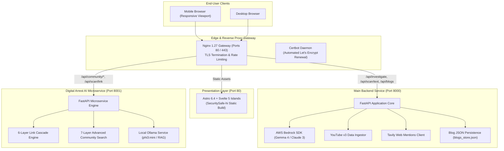
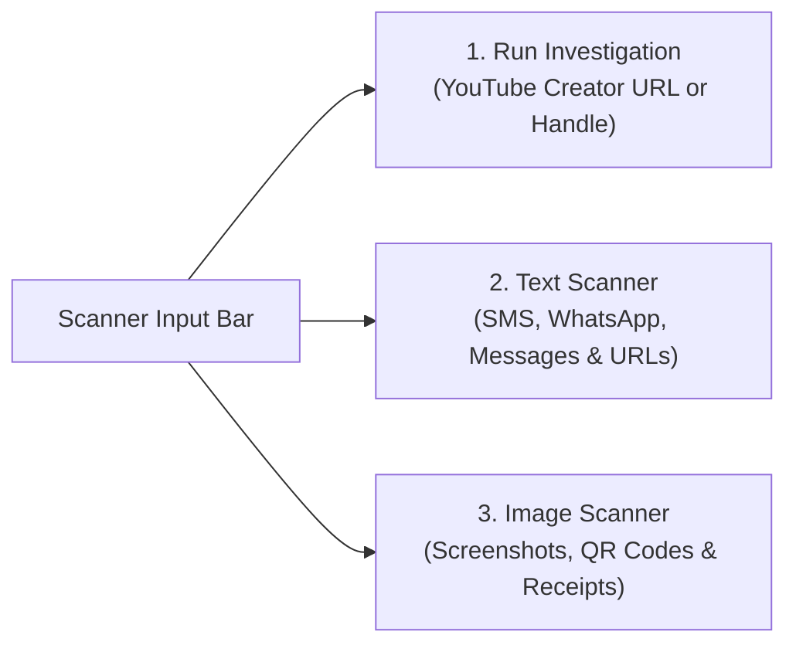
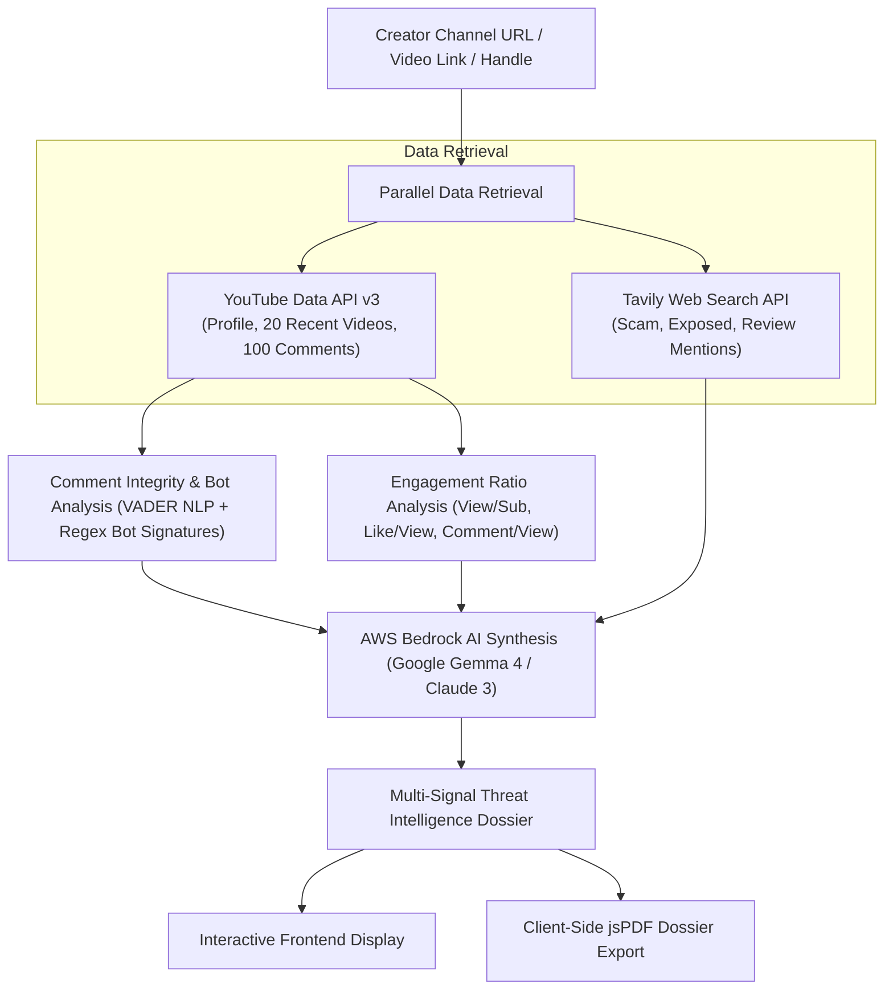
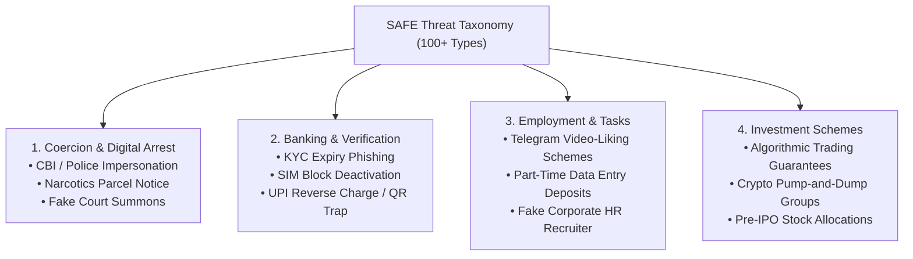
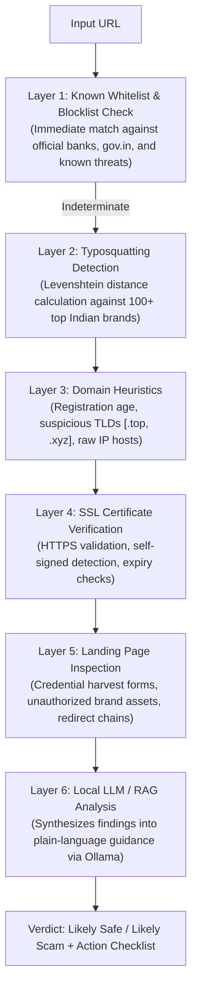
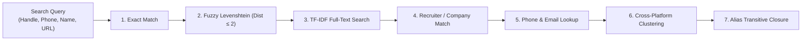
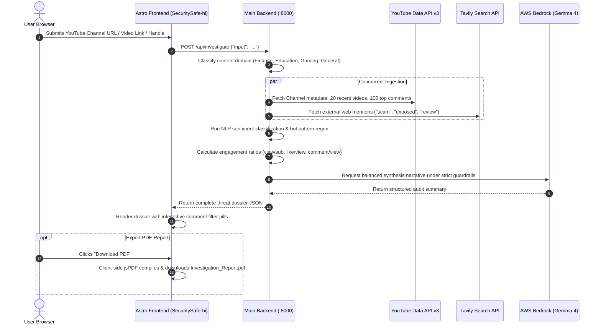
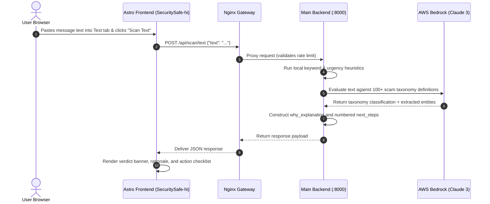
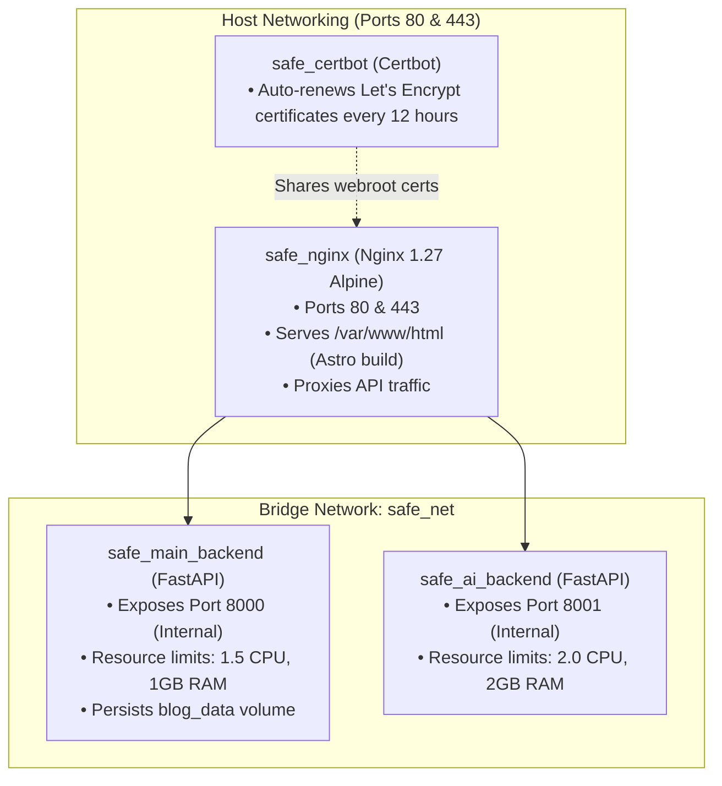

# SAFE (Security Safe) — Product Requirements Document (PRD)

**Document Version:** 2.0 (Final Engineering & Architecture Baseline)  
**Date:** September 20, 2026  
**Repository:** `KrishnaDubeycodeProjects/safe` (`temp_safe_repo`)  
**Frontend Implementation:** `SecuritySafe/SecuritySafe-hi` (Astro 6.4 + Svelte 5)  
**Document Status:** Approved Production Reference  
**Target Audience:** Engineering, Product, Security Operations, and Architecture Teams  

---

## Table of Contents

1. [Executive Summary](#1-executive-summary)
2. [Problem Statement & Threat Context](#2-problem-statement--threat-context)
3. [Core Product Principles](#3-core-product-principles)
4. [Target Personas & Use Cases](#4-target-personas--use-cases)
5. [System Architecture](#5-system-architecture)
   - 5.1 [End-to-End System Topology](#51-end-to-end-system-topology)
   - 5.2 [Microservices & Responsibilities](#52-microservices--responsibilities)
6. [Frontend Feature Specification (`SecuritySafe-hi`)](#6-frontend-feature-specification-securitysafe-hi)
   - 6.1 [Unified 3-Tab Scanner Interface](#61-unified-3-tab-scanner-interface)
   - 6.2 [Run Investigation (Abstracted Threat Dossier)](#62-run-investigation-abstracted-threat-dossier)
   - 6.3 [Text & Message Scanner](#63-text--message-scanner)
   - 6.4 [Image & Screenshot Scanner](#64-image--screenshot-scanner)
   - 6.5 [Emergency Response Center (`/emergency`)](#65-emergency-response-center-emergency)
   - 6.6 [Fraud Learning Center (`/learn`)](#66-fraud-learning-center-learn)
   - 6.7 [Blog Platform & Protected Admin CMS (`/blogs`, `/mgmt-x7k9p2`)](#67-blog-platform--protected-admin-cms-blogs-mgmt-x7k9p2)
   - 6.8 [Information & Utility Pages (`/about`, `/more`, `/feedback`)](#68-information--utility-pages-about-more-feedback)
7. [Main Backend Specification (`security-safe-chat-backend`)](#7-main-backend-specification-security-safe-chat-backend)
   - 7.1 [Endpoint Contracts](#71-endpoint-contracts)
   - 7.2 [100+ Scam Taxonomy Engine](#72-100-scam-taxonomy-engine)
8. [Digital Arrest Microservice Specification (`digital-arrest`)](#8-digital-arrest-microservice-specification-digital-arrest)
   - 8.1 [6-Layer Link Cascade Engine](#81-6-layer-link-cascade-engine)
   - 8.2 [7-Layer Community Registry Search Engine](#82-7-layer-community-registry-search-engine)
9. [End-to-End Data Flow Pipelines](#9-end-to-end-data-flow-pipelines)
   - 9.1 [YouTube Investigation Flow](#91-youtube-investigation-flow)
   - 9.2 [Text Message Scan Flow](#92-text-message-scan-flow)
10. [AI / ML Intelligence Layer](#10-ai--ml-intelligence-layer)
11. [Security, Privacy & Data Governance](#11-security-privacy--data-governance)
12. [Non-Functional Requirements (NFRs)](#12-non-functional-requirements-nfrs)
13. [Deployment & Infrastructure](#13-deployment--infrastructure)
14. [Third-Party Integrations & Environment Variables](#14-third-party-integrations--environment-variables)
15. [Repository Assets & Future Expansion Modules](#15-repository-assets--future-expansion-modules)

---

## 1. Executive Summary

**SAFE (Security Safe)** is a consumer-facing cybersecurity verification platform engineered to protect internet users from sophisticated social engineering, synthetic media manipulation, financial scams, and coercive extortion tactics such as **"Digital Arrest"**.

### Operational Tenets

- **Zero Friction**: No user registration, no authentication barriers, and no tracking cookies. Users verify content instantly on demand.
- **Auditable Multi-Signal Intelligence**: Unlike legacy systems that compress nuanced digital risk into an arbitrary 0–100 score, SAFE delivers an **Abstracted Multi-Signal Forensic Dossier**. This format provides 0–5 heuristic ratings across distinct operational dimensions, side-by-side balanced signal cards (anomalies vs. credibility), and client-side PDF export.
- **Tri-Vector Defense**:
  1. **Content Creators**: In-depth channel investigations (comment NLP, bot detection, engagement anomalies, and public mentions).
  2. **Text & Direct Messages**: Real-time classification across SMS, WhatsApp, and email using a structured taxonomy of 100+ scam types.
  3. **Visual Media & URLs**: OCR text extraction, visual artifact inspection, and a 6-layer Link Cascade detecting brand typosquatting.

---

## 2. Problem Statement & Threat Context

### The Cybercrime Landscape in India

The explosive expansion of digital transactions via the Unified Payments Interface (UPI), low-cost smartphone access, and accelerated digital onboarding have outpaced digital defense literacy, opening distinct vulnerability vectors:

1. **"Digital Arrest" Extortion**: Scammers pose as police officers, CBI agents, or narcotics officials over WhatsApp/Skype video calls. They produce forged warrants and subject victims to coercive continuous monitoring to extort bank transfers.
2. **Synthetic Social Proof on YouTube**: Fraudulent financial influencers deploy automated bot swarms to manufacture artificial positive sentiment in comments, misleading retail investors into speculative schemes.
3. **Impersonation & Brand Typosquatting**: Deceptive SMS alerts targeting banking customers (SBI, HDFC, ICICI, PNB) and utility payers utilize look-alike domains and urgent deadlines (e.g., "Electricity will be disconnected tonight").
4. **Absence of Unified Public Tooling**: Prior to SAFE, non-technical users had no single destination to verify links, SMS messages, and creator recommendations simultaneously.

---

## 3. Core Product Principles

| Principle | Technical & Product Implementation |
|---|---|
| **Zero Friction** | 100% free web app. Zero account creation, zero email capture, and no software installations. |
| **Rapid Latency** | Heuristic text scan in `< 1.0 second`; comprehensive creator threat dossier in `< 30 seconds`. |
| **Transparent Reasoning** | No unexplained black-box labels. Every verdict itemizes detected red flags and recommends exact next steps. |
| **No Artificial Scoring** | No arbitrary single 0–100 number for creators. Evaluations use balanced signal analysis and 0–5 heuristic scales. |
| **Strict Privacy** | Scanned texts and uploaded images are processed in volatile memory and never persisted to database logs. |

---

## 4. Target Personas & Use Cases

### Persona 1: The Retail Investor (Rahul, 28)
- **Context**: Follows financial trading influencers on YouTube.
- **Problem**: Enters a channel promising guaranteed monthly stock returns. Comments are overwhelmingly positive.
- **SAFE Solution**: Runs an Investigation. Discovers that bot-pattern comments exceed 35%, engagement ratios deviate significantly from category norms, and external news articles flag the creator.

### Persona 2: The Anxious Household Member (Sunita, 55)
- **Context**: Receives an urgent SMS: *"Your SBI bank account is suspended due to missing PAN. Update immediately via link."*
- **Problem**: Cannot determine if the notification is genuine and fears losing access to savings.
- **SAFE Solution**: Pastes the message into the Text Scanner. Receives an immediate red verdict: Banking Phishing Scam (95% confidence), highlighting urgency keywords and providing safe verification numbers.

### Persona 3: The Target in Crisis (Mohan, 62)
- **Context**: Under an active "digital arrest" video call with individuals claiming to be law enforcement.
- **Problem**: Panicking, coerced into transferring life savings into an "escrow clearance account."
- **SAFE Solution**: Accesses the Emergency Center (`/emergency`). Follows high-contrast panic guidance: terminates the call, dials the 1930 Cyber Helpline, and initiates account protection.

---

## 5. System Architecture

### 5.1 End-to-End System Topology

### 5.2 Microservices & Responsibilities

| Container / Service | Port | Technology | Primary Responsibilities |
|---|---|---|---|
| **`safe_nginx`** | 80, 443 | Nginx 1.27 Alpine | Reverse proxy, TLS termination, SSL renewal via Certbot, and rate limiting. |
| **`SecuritySafe-hi`** | Static | Astro 6.4 + Svelte 5 | User interface, client-side jsPDF generator, responsive scanner tabs, and emergency guides. |
| **`safe_main_backend`** | 8000 | FastAPI + Python 3.13 | YouTube investigation pipeline, 100+ scam taxonomy classification via AWS Bedrock, and blog management. |
| **`safe_ai_backend`** | 8001 | FastAPI + Python 3.13 | 6-layer Link Cascade, 7-layer community registry search, and local Ollama inference. |

---

## 6. Frontend Feature Specification (`SecuritySafe-hi`)

The frontend application resides in `temp_safe_repo/SecuritySafe/SecuritySafe-hi`.

### 6.1 Unified 3-Tab Scanner Interface

The main interactive scanner (`ScannerInput.astro`) features a segmented control with three modes:

- **Styling Architecture**: Clean segmented layout with `#F1F5F9` background.
- **Mobile Responsive Design**: Outer borders are completely removed on mobile (`@media (max-width: 768px)` and `@media (max-width: 480px)`), preserving an unbordered, edge-to-edge layout that prevents viewport overflow.

---

### 6.2 Run Investigation (Abstracted Threat Dossier)

Processes YouTube channel URLs, video links, or creator handles without reducing findings to an arbitrary composite score.

#### Dossier Output Structure

1. **Header & Target Metadata**: Status Indicator Dot (Green / Amber / Red), Target Handle, Content Domain badge, and data coverage indicators.
2. **AI Signal Synthesis & Reasoning Banner**: Plain-language audit narrative verified through automated guardrails:
   - *Both sides represented*
   - *No verdict leakage*
   - *Heuristic boundaries enforced*
   - *Descriptive signal analysis*
3. **Balanced Comparative Signals (Side-by-Side)**:
   - **Signals Raising Questions**: Identified anomalies (e.g., bot density, engagement mismatch, negative mentions).
   - **Signals Supporting Credibility**: Verified credentials (e.g., organic sentiment, active channel longevity).
4. **Forensic Dimension Indicators**: Six heuristic dimensions evaluated on a standardized **0 to 5 signal scale**:
   - Bot & Spam Density
   - Sentiment Authenticity
   - Engagement Metric Alignment
   - Content Pattern Integrity
   - External Web Reputation
   - Multi-Platform Consistency
5. **Comment Integrity Analysis**: Visual percentage distribution bar (Organic Positive, Neutral, Negative) and bot percentage. Includes interactive filter pills (`All`, `Positive`, `Neutral`, `Negative`, `Bot/Spam`) to inspect real comment evidence.
6. **Third-Party Web Mentions & External Search**: External news articles and community reviews. Styled with domain tags and complete word wrapping on mobile screens.
7. **Client-Side PDF Export**: Download button compiling an `Investigation_Report.pdf` directly in the browser via `jsPDF`.

---

### 6.3 Text & Message Scanner

Processes pasted messages, SMS texts, WhatsApp forwards, emails, and links:
- **Result Presentation (`ScannerResult.astro`)**:
  - Full-width status banner (`Likely Scam`, `Likely Safe`, or `Invalid request`).
  - **"Why it's a scam / safe"**: Rationale citing identified threat markers.
  - **"Next steps"**: Numbered defensive checklist (e.g., "Do not share OTP", "Block sender", "File report on 1930").
  - **"Start Scanning"**: Resets the interface for subsequent checks.

---

### 6.4 Image & Screenshot Scanner

Accepts uploaded or pasted images (PNG, JPEG, WebP up to 10MB):
- **Processing**: Extracts text via OCR and scans for visual manipulation markers.
- **Result Presentation (`ScannerResult.astro`)**:
  - Banner verdict.
  - **Visual Evidence List**: Bullet points identifying visual red flags, forged seals, or manipulated typography.
  - **Extracted Text Box**: Monospace display of all text extracted from the screenshot.
  - Numbered action guidance and reset button.

---

### 6.5 Emergency Response Center (`/emergency`)

A dedicated emergency interface optimized for rapid access:
- **Instant Helplines**: Click-to-dial for the National Cyber Crime Helpline (`1930`) and Emergency Services (`112`).
- **Digital Arrest Triage Guide**: Step-by-step guidance for users actively targeted by impersonators.
- **Golden Hour Checklist**: Protocols for freezing bank accounts and securing transaction UTR references.

---

### 6.6 Fraud Learning Center (`/learn`)

Interactive educational hub structured by fraud vectors:
- Bite-sized pattern cards covering Digital Arrest, job fraud, SIM swap schemes, and UPI cashback traps.
- Interactive "Spot the Red Flag" scenario quizzes with instant feedback.

---

### 6.7 Blog Platform & Protected Admin CMS (`/blogs`, `/mgmt-x7k9p2`)

- **Public Awareness Feed (`/blogs`, `/blogs/[id]`)**: Educational articles on current scam schemes with reading time indicators and tag filters.
- **Admin Management Gate (`/mgmt-x7k9p2`)**:
  - Protected by a client-side SHA-256 password hash challenge.
  - Communicates with backend endpoints requiring the `X-Admin-Key` header.
  - Supports creating, editing, and deleting blog entries stored in `blogs_store.json`.

---

### 6.8 Information & Utility Pages (`/about`, `/more`, `/feedback`)

- **About Page (`/about`)**: Details the platform mission and vision as a dedicated cyber safety assistant.
- **More Resources (`/more`)**: Reference guides, emergency contacts, and platform FAQs.
- **Feedback Portal (`/feedback`)**: Feedback form logging submissions to `feedback_submissions.jsonl`.

---

## 7. Main Backend Specification (`security-safe-chat-backend`)

FastAPI application running on **Python 3.13** at **Port 8000** (compatible with Docker and AWS Lambda via Mangum).

### 7.1 Endpoint Contracts

| HTTP Method | Path | Request Body / Parameters | Response Schema | Purpose |
|---|---|---|---|---|
| `GET` | `/health` | None | `{"status": "ok"}` | Service health probe. |
| `POST` | `/api/investigate` | `{"input": "string"}` | `ThreatDossierResponse` | Complete YouTube creator threat investigation. |
| `POST` | `/api/scan/text` | `{"text": "string"}` | `TextScanResponse` | Scam classification using 100+ taxonomy definitions. |
| `POST` | `/api/scan/image` | Multipart `file` | `ImageScanResponse` | OCR text extraction and multimodal scam analysis. |
| `GET` | `/api/blogs` | None | `Array<BlogPost>` | Retrieves published blogs from JSON storage. |
| `POST` | `/api/blogs` | `BlogPostPayload` + `X-Admin-Key` | `BlogPost` | Creates or updates a blog post. |
| `DELETE` | `/api/blogs/{id}` | Path `id` + `X-Admin-Key` | `{"deleted": true}` | Removes a blog post. |
| `POST` | `/api/feedback` | `{"feedback": "...", "email": "..."}` | `{"status": "recorded"}` | Appends feedback to JSONL and triggers notification. |

---

### 7.2 100+ Scam Taxonomy Engine

The text analysis pipeline classifies inputs against a hierarchical taxonomy:

---

## 8. Digital Arrest Microservice Specification (`digital-arrest`)

Specialized FastAPI microservice running on **Port 8001** responsible for local inference and community data.

### 8.1 6-Layer Link Cascade Engine

Evaluates suspicious URLs through six sequential verification layers:

---

### 8.2 7-Layer Community Registry Search Engine

The community lookup engine (`utils/advanced_search_engine.py`) searches reported entities using a 7-stage query cascade:

---

## 9. End-to-End Data Flow Pipelines

### 9.1 YouTube Investigation Flow

---

### 9.2 Text Message Scan Flow

---

## 10. AI / ML Intelligence Layer

| Model / Component | Implementation / Source | Execution Location | Functional Role |
|---|---|---|---|
| **Claude 3 Haiku** | AWS Bedrock | Main Backend (:8000) | Fast text classification mapped against the 100+ scam taxonomy. |
| **Google Gemma 4 (31B)** | AWS Bedrock / Mantle | Main Backend (:8000) | Synthesis of balanced creator audit narratives and reasoning reports. |
| **Gemma-3-27b-it** | Mantle Multimodal | Main Backend (:8000) | Dual-axis image analysis (scam intent and synthetic manipulation). |
| **Ollama (`phi3:mini`)** | Local Container Runtime | Digital Arrest (:8001) | Local edge LLM inference and offline link cascade reasoning. |
| **TF-IDF + Classifier** | Scikit-Learn (Local) | Digital Arrest (:8001) | Fast text scam probability scoring and community search indexing. |
| **VADER NLP** | NLTK (Local) | Main Backend (:8000) | Compound sentiment polarity scoring on YouTube comments. |

---

## 11. Security, Privacy & Data Governance

### 11.1 Privacy by Design
- **Zero Account Footprint**: No user registration, passwords, sessions, or profile records.
- **Ephemeral Scan Lifecycle**: All scanned texts, URLs, and images are analyzed in volatile memory and discarded immediately following response delivery.
- **Automated PII Sanitization**: Indian phone numbers (`+91`), Aadhaar numbers, and credit card patterns in community reports are automatically redacted.

### 11.2 Application Defense & Hardening
- **Rate Limiting**: `SlowAPI` middleware limits request frequencies on all API endpoints.
- **Host & CORS Whitelisting**: `TrustedHostMiddleware` blocks host-header injection. Wildcard origins are disabled in production.
- **Input Validation**: All API bodies and parameters are strictly validated via Pydantic schemas.
- **Admin Access Control**: Blog management endpoints require the `X-Admin-Key` header matching an environment-stored SHA-256 password hash.
- **Production Endpoint Hardening**: Swagger (`/docs`) and ReDoc endpoints are automatically stripped in production builds.

---

## 12. Non-Functional Requirements (NFRs)

| Dimension | Target Metric | Implementation Mechanism |
|---|---|---|
| **Text Scan Response Time** | P95 < 1.0 second | In-memory heuristics combined with fast Bedrock streaming. |
| **Investigation Response Time** | P95 < 30.0 seconds | Concurrent asynchronous requests to YouTube and Tavily APIs. |
| **Availability Target** | 99.5% Uptime | Container health checks and static edge delivery via Vercel/Nginx. |
| **Throughput Capacity** | 100+ concurrent requests | Asynchronous FastAPI execution with tuned Uvicorn worker pools. |
| **Mobile Responsiveness** | Breakpoint support down to 320px | Mobile-first CSS, flex wrapping, and responsive overflow containment. |
| **Accessibility Standard** | WCAG 2.1 Level AA | High-contrast status badges, semantic headings, and descriptive text. |

---

## 13. Deployment & Infrastructure

### 13.1 Production Docker Compose Architecture

The application is orchestrated via `docker-compose.prod.yml`:

### 13.2 Automated Deployment Script (`deploy.sh`)

The automated deployment script executes an 8-stage verification pipeline:
1. **Pre-flight Checks**: Confirms presence of Docker, Docker Compose, Node.js, and npm.
2. **Environment Validation**: Validates presence of `.env` files across frontend and backend directories.
3. **Admin Credential Setup**: Computes SHA-256 hash for admin access control.
4. **Static Frontend Compilation**: Executes `npm ci && npm run build` inside `SecuritySafe-hi`.
5. **Container Builds**: Compiles Docker images for `main-backend` and `ai-backend`.
6. **SSL Setup**: Manages Certbot certificate renewal and validation.
7. **Zero-Downtime Deployment**: Restarts application containers via `docker-compose up -d`.
8. **Smoke Testing**: Verifies `/health` endpoints and confirms API documentation is masked.

---

## 14. Third-Party Integrations & Environment Variables

| Service / Dependency | Environment Variable | Target Service | Purpose |
|---|---|---|---|
| **YouTube Data API v3** | `YOUTUBE_API_KEY` | Main Backend (`:8000`) | Retrieves channel statistics, recent uploads, and comments. |
| **Tavily Search API** | `TAVILY_API_KEY` | Main Backend (`:8000`) | Queries external web mentions, reviews, and exposure articles. |
| **AWS Bedrock** | `AWS_ACCESS_KEY_ID` / `AWS_SECRET_ACCESS_KEY` | Main Backend (`:8000`) | LLM inference for taxonomy classification and audit synthesis. |
| **OCR.space API** | `OCR_SPACE_API_KEY` | Main Backend (`:8000`) | Text extraction from uploaded screenshots and receipts. |
| **Admin Secret Key** | `ADMIN_KEY` | Main Backend (`:8000`) | Authentication token for blog creation, editing, and deletion. |
| **Frontend API Target** | `PUBLIC_MAIN_API_URL` | Frontend (`SecuritySafe-hi`) | Configures the gateway URL for backend API requests. |

---

## 15. Repository Assets & Future Expansion Modules

The `temp_safe_repo` codebase contains pre-architected assets in `SecuritySafe-future_updates` ready for future release cycles:

| Directory | Component / Page | Functional Scope |
|---|---|---|
| `component/` | `CheckupCard.astro` | Interactive checklist for personal digital security audits. |
| `component/` | `NewsCard.astro` | Cyber safety news dispatches and threat bulletins. |
| `component/` | `ReportForm.astro` | Multi-step community scam incident report submission form. |
| `component/` | `ScoreDashboard.astro` | Dashboard for personal digital security hygiene scoring. |
| `component/` | `ThreatAlert.astro` | Real-time broadcast warning banner for active fraud campaigns. |
| `pages/` | `PhishingSimSwap.svelte` | Interactive training simulator for Phishing and SIM Swap attacks. |
| `pages/` | `Sextortion.svelte` | Emergency response workflow for cyber blackmail incidents. |
| `pages/` | `checkup.astro` | Comprehensive personal digital health checkup page. |
| `pages/` | `database.astro` | Searchable directory of verified scam patterns and threat profiles. |
| `pages/` | `report.astro` | Incident reporting portal for community threat submissions. |
| `pages/` | `score.astro` | Interactive digital hygiene evaluation calculator. |

---

*This document reflects the verified codebase, frontend components, and backend microservices of `temp_safe_repo` as of September 20, 2026.*
