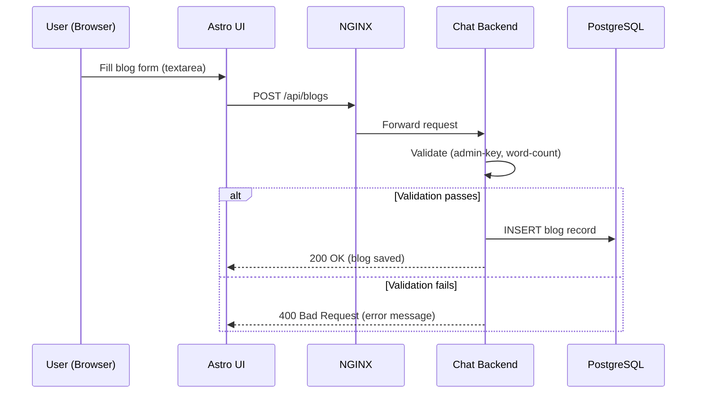
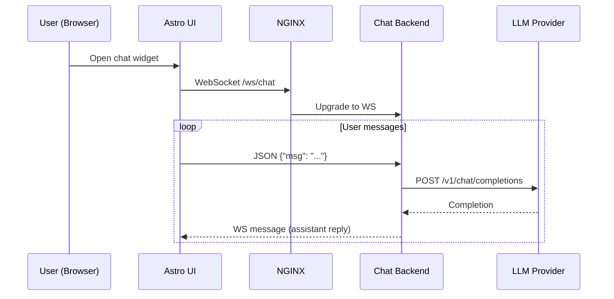
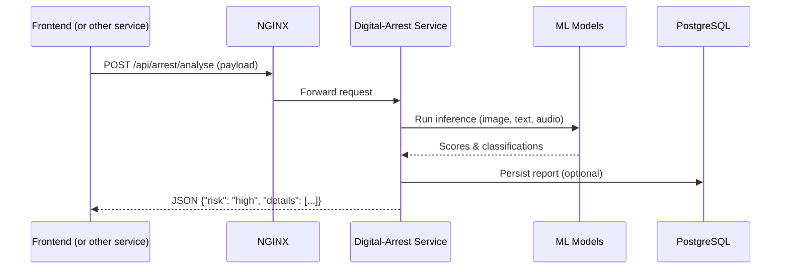
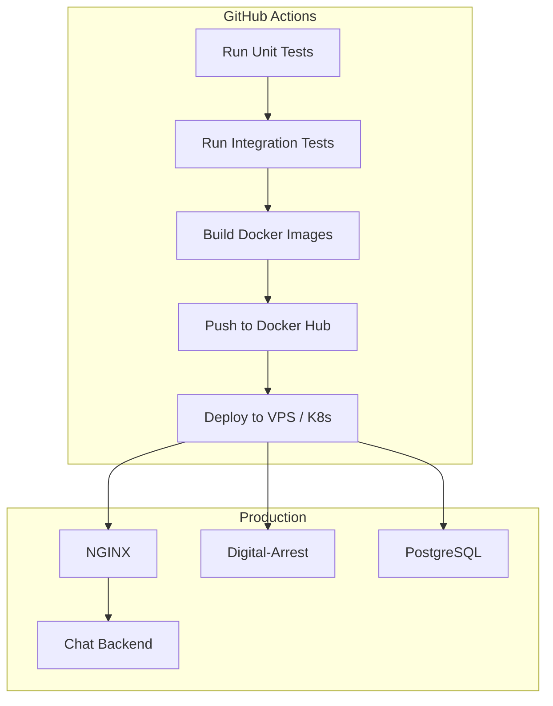

# Comprehensive PRD & Architecture for **Safe** Project

---

## 1. Project Overview

**Name**: Safe (Security Safe)  
**Repository**: https://github.com/KrishnaDubeycodeProjects/safe  
**Purpose**: A unified platform that provides:
- A modern **frontend UI** for blog publishing, community interaction, and emergency alerts.
- A **chat‑backend** (FastAPI) for AI‑driven safety assistance.
- A **digital‑arrest** micro‑service that performs content‑risk analysis, image‑to‑text extraction, and community reporting.

The system is intended for organizations that need a secure, extensible, and privacy‑focused safety portal.

---

## 2. Goals & Success Metrics

| Goal | Description | Success Metric |
|------|-------------|----------------|
| **Secure Content Submission** | Users can publish blogs only after passing validation (minimum word count, admin‑key). | < 0.1 % rejected submissions due to validation errors. |
| **AI‑Assisted Safety Chat** | Provide quick safety advice via an LLM‑powered chat. | Average response time < 2 seconds, user satisfaction ≥ 4/5. |
| **Digital‑Arrest Detection** | Detect scam links, deep‑fake images, and spam SMS. | Detection precision ≥ 92 % on test suite. |
| **Scalable Deployment** | All services must be container‑ready and deployable on a single VM or Kubernetes. | Zero‑downtime deployments, rolling updates supported. |
| **Observability** | Centralised logging, metrics, and health‑checks. | Alerts triggered < 5 min after failure. |

---

**Explanation**
- The **frontend** is a static site built with Astro; it communicates with the API gateway.
- **NGINX** acts as a reverse‑proxy and terminates TLS.
- The **Chat Backend** handles user sessions, calls the LLM, and writes logs to Supabase.
- **Digital‑Arrest** is a separate FastAPI service exposing risk‑analysis endpoints.
- All persistence lives in a **PostgreSQL** instance (hosted on Supabase for simplicity).
- Large binary model files are stored via **Git‑LFS**.

---

## 3. Detailed Tech Stack

| Layer | Technology | Rationale |
|-------|------------|-----------|
| **Frontend** | Astro (static site generator) + Tailwind (optional) + Vanilla CSS | Compile‑time rendering, fast page loads, easy component model. |
| **UI Components** | Svelte (used for emergency pages) | Reactive UI for real‑time alerts. |
| **Backend (Chat)** | FastAPI (Python 3.13) | High performance, async, automatic OpenAPI docs. |
| **Backend (Digital‑Arrest)** | FastAPI (Python 3.13) | Keeps service boundaries clear. |
| **LLM Provider** | OpenAI / Anthropic (via `openai` SDK) | Proven large‑model APIs with safety controls. |
| **Database** | PostgreSQL (Supabase) | ACID guarantees, built‑in auth & storage. |
| **Object Storage** | Supabase bucket (for uploaded images/audio) |
| **ML Models** | - Vosk (speech‑to‑text)  \n- Keras (deep‑fake detection)  \n- Scikit‑Learn TF‑IDF + Logistic (spam detection) |
| **Containerisation** | Docker + Docker‑Compose (prod)  \n- `docker-compose.prod.yml` orchestrates NGINX, chat‑backend, digital‑arrest, DB. |
| **CI/CD** | GitHub Actions (build, test, push LFS, deploy) |
| **Observability** | - Loki/Grafana for logs  \n- Prometheus for metrics  \n- Health endpoints (`/healthz`) |
| **Infrastructure** | - Single‑VM (Ubuntu 22.04) or K8s cluster  \n- TLS via Let’s Encrypt (certbot) |

---

## 5. Core Functional Flow

### 4.1 Blog Submission Flow

### 4.2 Chat Interaction Flow

### 4.3 Digital‑Arrest Risk‑Analysis Flow

---

## 5. Deployment & CI/CD Pipeline

**Steps**
1. On PR merge to `main`, GitHub Actions run the test suite.
2. Docker images are built (`chat-backend`, `digital-arrest`, `nginx`).
3. Images are pushed to a private registry.
4. A deployment job SSHs into the target VM, pulls images, and runs `docker‑compose -f docker-compose.prod.yml up -d`.
5. Health‑checks verify service availability before marking the deployment successful.

---

## 6. Non‑Functional Requirements

| Category | Requirement |
|----------|--------------|
| **Performance** | API latency < 200 ms for chat & analysis; static assets served with < 50 ms TTL.
| **Scalability** | Horizontal scaling via Docker Swarm/K8s; each service stateless except DB.
| **Security** | - JWT for API auth (admin‑key stored in `.env`).  \n- All traffic TLS‑encrypted.  \n- Input sanitisation/validation.  \n- Secret management via GitHub Secrets & `.env` files (never committed).
| **Reliability** | 99.9 % uptime SLA; redundant DB backups nightly.
| **Maintainability** | Separate repositories could be split later; clear API contracts via OpenAPI spec.
| **Observability** | Structured JSON logs, Prometheus metrics, Grafana dashboards.
| **Compliance** | GDPR‑compliant data handling; option to delete user data via API.

---

## 7. Open Issues & Future Enhancements

- **Mobile app**: Build native React Native client for push notifications with complete inflow messages via locally running the bonsai-227B.
- **Role‑based access control**: Extend admin key model to granular permissions.
- **Advanced LLM safety**: Integrate content‑filtering pipelines.
- **Kubernetes migration**: Move from Docker‑Compose to Helm charts for easier scaling.
- **Search**: Add full‑text search (Supabase + Elastic) for blogs and reports.

---

## 9. References
- `README.md` in each sub‑module.
- `.env.example` files for configuration.
- `docker-compose.prod.yml` for production orchestration.
- OpenAPI spec generated at `http://localhost/docs` for both backends.

---

*Document generated on 2026‑08‑08.*
